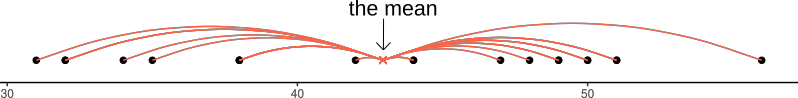
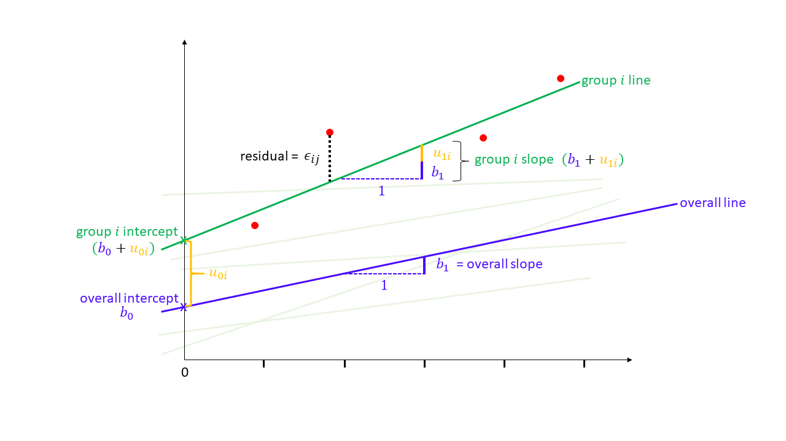
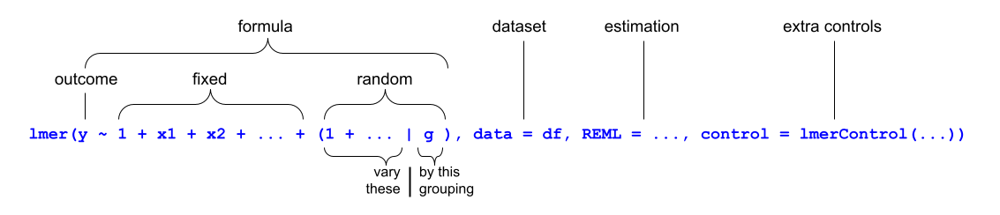
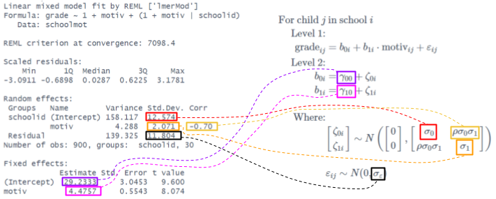
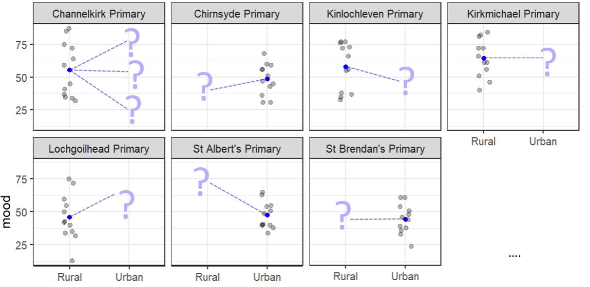
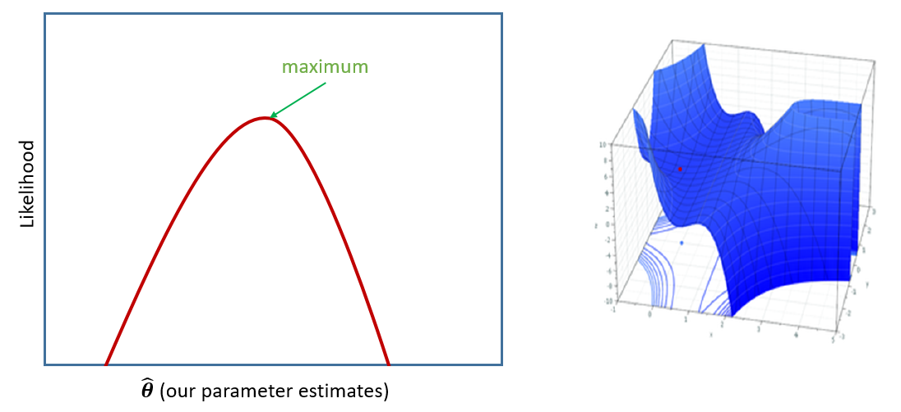

```{r}
#| label: setup
#| include: false
source('assets/setup.R')
library(xaringanExtra)
library(tidyverse)
library(patchwork)
xaringanExtra::use_panelset()

schoolmood <- read_csv("../../data/moodphysed.csv") |>
  mutate(schoolid=factor(gsub(" School", "", schoolid)))
srmod <- lm(mood ~ outdoordays, data = schoolmood)
```


:::lo
This reading:  

- Introducing the mixed effects (or "multi-level") regression model
- _Partially_ pooling information across groups
- Fitting mixed models in R
- Model estimation and convergence

::: {.callout-warning collapse="true"}
#### Different names for the same thing

The methods we're going to start to look at are known by lots of different names (see @fig-wordcloud). The core idea is that **model parameters vary at more than one level.**. 

```{r}
#| echo: false
#| label: fig-wordcloud
#| fig-cap: "size weighted by hits on google scholar search (sept 2020)"  
tribble(
  ~word, ~freq,
  "multi-level model", 154000 + 31300,
  "hierarchical linear model", 24000,
  "mixed-effects model", 56500 + 191000,
  "mixed model", 1500000,
  "random coefficient model", 11200+6920,
  "random-effects model", 101000 + 501000,
  "random parameter model", 2140 + 1460,
  "random-intercept model", 17100 + 2930, 
  "variance components model", 6210 + 5560,
  "partial pooling", 5120,
  "mixed error-component model", 62,
  "random slope model", 4010 + 1620,
  "panel data model", 55400,
  "latent curve model", 1520,
  "growth curve model", 18400
) -> mlmname


mlmname$freq[mlmname$freq > 100000] <- c(85000,85000, 110000,70000,95000)*1.5

#wordcloud2(mlmname, shape="diamond", size=.4)
library(wordcloud)
wordcloud(words = mlmname$word, freq = mlmname$freq, random.order=FALSE,
          min.freq=1,
          scale=c(4,.5),
          rot.per=0,
          fixed.asp=T,
          #ordered.colors=T,
          colors="#a41ae4")
```

:::

:::


# Linear Models

For the standard linear regression model, we wrote the equation as:  

$$
\color{red}{y} = \color{blue}{b_0 + b_1x_{1} \ + \ ... \ + \ b_px_{p}} \color{black}{\ + \ \varepsilon}
$$

In this model, the estimated coefficients $\color{blue}{b_0}$, $\color{blue}{b_1}$ etc., are fixed "constants", i.e., when the model is estimated, we have a single numeric value for $b_0$, and a single numeric value for $b_1$, for $b_2$ and so on, and that's it.  

Let's return to the example from [Chapter 1](01_clustered.html) where we are interested in modelling school children's positive mood as a function of how many days of outdoor physical education (PE) they did. We fit a simple regression model of `lm(mood ~ outdoordays)`, and we get out two estimated parameters --- an intercept and a slope --- that define one line (as in @fig-schoolplot1).  
 
```{r}
#| echo: false
#| label: fig-schoolplot1
#| fig-cap: "Mood predicted by number of PE sessions held outdoors. The simple linear regression model defines the height and slope of the black line."
library(lme4)
library(ggdist)
library(distributional)
fmod = lm(mood~outdoordays,schoolmood)
rimod = lmer(mood~outdoordays+(1|schoolid),schoolmood)
rsmod = lmer(mood~outdoordays+(1+outdoordays|schoolid),schoolmood)
basep = ggplot(schoolmood, aes(x=outdoordays,y=mood))+
  geom_jitter(alpha=.3,width=.2,height=0,aes(col=schoolid)) +
  guides(col="none")+
  geom_vline(xintercept=0,lty="dashed")+
  scale_x_continuous(limits=c(-1,6),breaks=0:5)

basep + geom_abline(intercept=coef(fmod)[1],slope=coef(fmod)[2], lwd=1) +
  #geom_point(alpha=.1,col="black") +
  geom_point(x=0,y=coef(fmod)[1],size=3,col="blue") +
  annotate("text",label=expression(b["0"]),
           col="blue",size=5,
           x=0,y=coef(fmod)[1],hjust=-.2,vjust=1.2)+
  
  annotate("text",label=expression(b["1"]),
           col="blue",size=5,
           x=1.5,y=coef(fmod)[1]+1,hjust=-.2,vjust=1)+
  geom_segment(x=1,xend=1.5,y=coef(fmod)[1]+2,yend=coef(fmod)[1],
               col="blue")+
  geom_segment(x=0,xend=1,
               y=(coef(fmod) %*% c(1,0))[1],
               yend=(coef(fmod) %*% c(1,0))[1]) +
  geom_segment(x=1,xend=2,
               y=(coef(fmod) %*% c(1,1))[1],
               yend=(coef(fmod) %*% c(1,1))[1]) +
  geom_segment(x=2,xend=3,
               y=(coef(fmod) %*% c(1,2))[1],
               yend=(coef(fmod) %*% c(1,2))[1]) + 
  geom_segment(x=3,xend=4,
               y=(coef(fmod) %*% c(1,3))[1],
               yend=(coef(fmod) %*% c(1,3))[1]) + 
  geom_segment(x=1,xend=1,
               y=(coef(fmod) %*% c(1,0))[1],
               yend=(coef(fmod) %*% c(1,1))[1],col="blue",lwd=1) +
  geom_segment(x=2,xend=2,
               y=(coef(fmod) %*% c(1,1))[1],
               yend=(coef(fmod) %*% c(1,2))[1],col="blue",lwd=1) +
  geom_segment(x=3,xend=3,
               y=(coef(fmod) %*% c(1,2))[1],
               yend=(coef(fmod) %*% c(1,3))[1],col="blue",lwd=1) +
  geom_segment(x=4,xend=4,
               y=(coef(fmod) %*% c(1,3))[1],
               yend=(coef(fmod) %*% c(1,4))[1],col="blue",lwd=1) 
  
  
```

In this case, our model completely ignores what school a child is from. For any child that had 0 days of outdoor PE, then our model predicts that their reported mood score will be `r round(coef(srmod)[1],1)` (the intercept of our model).  

```{r}
# TODO schoolmood <- read_csv("../../data/moodphysed.csv")
srmod <- lm(mood ~ outdoordays, data = schoolmood)
```
```{r}
#| echo: false
.pp(summary(srmod),l=list(0,9:13))
```

To make this clearer, we might write our model equation with the subscript $i$ to indicate write the equation for a specific given child $i$ in our data:    

$$
\begin{align}
&\text{For child }i \\
&\text{mood}_i = b_0 + b_1 \cdot \text{outdoordays}_i + \varepsilon_i \\
\end{align}
$$
For *any* given child $i$, we are modelling child $i$'s mood ($\text{mood}_i$) as a one number ($b_0$) plus some amount ($b_1$) times the number of days of outdoor PE that child $i$ had ($\text{outdoordays}_i$), plus some error ($\varepsilon_i$).  

The issue, as we saw in [Chapter 1](01_clustered.html#group-structured-data), is that the children in our study are actually related to one another in that they can be grouped into the schools that we sampled them from. It's entirely possible (and likely) that there are school-level differences might actually account for quite a lot of the variation in children's moods. In the previous reading we actually estimated that school differences account for approximately `r round(suppressWarnings(ICC::ICCbare(schoolid, mood, data = schoolmood)),2)*100`% of the variation in moods ([Chapter 1-#ICC](01_clustered.html#icc---quantifying-clustering-in-an-outcome-variable)).  

One option we briefly touched upon is to consider adding in the `schoolid` variable as a predictor to our linear model to estimate all of the school-level differences (`lm(mood ~ schoolid + outdoordays)`). This is a good start, and may oftentimes be perfectly acceptable if our groupings (the schools) are simply a nuisance thing that we want to account for - adding in the school grouping as another predictor will completely account for *all* school-level variability in our outcome variable.  

More frequently, however, groups like our schools here are themselves additional units of observation that have features of interest to us. For instance, we may be interested in how the location of a school (urban vs rural) moderates the association between amount of outdoor PE children get and their mood - i.e. we're interested in things that happen both at the child-level (number of days of ourdoor PE, mood), *and* at the school-level (urban v rural). For these scenarios, we really need a mixed effects model.  


<!-- ::: {.callout-note collapse="true"} -->
<!-- #### clusters as fixed effects -->

<!-- We have already seen that we can include fixed effects for cluster differences (we referred to this as "no pooling").   -->

<!-- e.g. to fit school-level differences in grades, we could use: -->
<!-- ```{r} -->
<!-- #| eval: false -->
<!-- femod <- lm(grade ~ motiv + schoolid, data = schoolmood) -->
<!-- ``` -->

<!-- The model equation for this would look something like: -->
<!-- $$ -->
<!-- \begin{align} -->
<!-- \text{For child }i& \\ -->
<!-- \text{grade}_i =\, &b_0 + b_1 \cdot \text{motiv}_i + b_2 \cdot \text{isSchool2}_i + b_3 \cdot \text{isSchool3}_i\,\, + \,\, ... \,\, + \\ -->
<!-- & ... + \,\, ... \,\, + \,\, ... \,\, + \\ -->
<!-- & b_p \cdot \text{isSchoolP}_i\,\, + \epsilon_i  -->
<!-- \end{align} -->
<!-- $$ -->

<!-- The school coefficients are a series of dummy variables that essentially toggle on or off depending on which school child $i$ is from.  -->

<!-- Because these set of coefficients account for **all** of the school-level differences in grades, it means we are then unable to consider other school-level variables like `funding` (how much govt funding the school receives). If we try, we can see that a coefficient for `funding` is not able to be estimated because `schoolid` is explaining everything school-related:     -->

<!-- ```{r} -->
<!-- #| eval: false -->
<!-- femod2 <- lm(grade ~ motiv + schoolid + funding, data = schoolmood) -->
<!-- summary(femod2) -->
<!-- ``` -->
<!-- ``` -->
<!-- Coefficients: (1 not defined because of singularities) -->
<!--                                   Estimate  Std. Error t value Pr(>|t|)     -->
<!-- (Intercept)                       33.1420   2.8257     11.729  < 2e-16 *** -->
<!-- motiv                             4.8107    0.4145     11.606  < 2e-16 *** -->
<!-- schoolidArdnamurchan High School -9.6072    3.1035    -3.096   0.00203 **  -->
<!-- schoolidBalwearie High School    -16.6493   3.0922    -5.384   9.36e-08 *** -->
<!-- ...                               ...       ...        ...     ...  -->
<!-- ...                               ...       ...        ...     ...  -->
<!-- funding                           NA        NA         NA      NA   -->
<!-- ``` -->

<!-- ::: -->


<div class="divider div-transparent div-dot"></div>

# Linear 'Mixed Effects' (or 'Multilevel') Models

The mixed effects model is an extension of the linear regression model that accounts for group-level differences in a more flexible and parsimonious way. It achieves this by taking some of the estimated coefficients (the $b_?$'s) in our linear regression model and modelling these as varying by groups (i.e. groups have different values for $b_?$, and we model how much they vary).  

Let's see how this works by starting with the intercept, $b_0$.  

## Random Intercepts

To extend the single-level regression model to the mixed effects regression model, we go from defining a parameter as a single number (such as $b_0$ for the intercept), to defining it in two parts (a "mix"): a single number and a deviation for each group $i$. 

$$
\begin{align}
\text{For observation }j&\text{ in group }i \\
\quad \\
\color{red}y_{ij} &\color{black}= \underbrace{(\color{blue}b_{0} \color{black}+ \color{orange}u_{0i}\color{black})}_{intercept} + \color{blue}b_{1} \cdot x_{ij} \color{black}+  \varepsilon_{ij} \\ 
\quad \\
\color{orange}{u_{0i}} &\sim N(0,\color{orange}{\sigma^2_0}) \\
\varepsilon_{ij} &\sim N(0,\sigma^2_\varepsilon) \\
\end{align}
$$  

Note that to do this we've had to add an extra subscript - we define an individual value of the outcome as being the value for observation $j$ from group $i$.^[Some books use "group $j$ >> observation $i$", others use "group $i$ >> observation $j$". We use the latter here]

So for any given group $i$, the intercept is now defined as the sum of a fixed constant $\color{blue}{b_0}$ and the deviation for that group $\color{orange}{u_{0i}}$.  

::: {.callout-caution collapse="true"}
#### Rabbit Hole: "multi-level" notation  

Sometimes you will see the same model structure written differently, in such a way that separates out the different levels of observation (i.e., observations and groups):  

$$
\begin{align}
\text{For observation }j&\text{ in group }i \\
\text{Level 1:}& \\
\color{red}y_{ij} &\color{black}= \color{green}b_{0i} \color{blue} + b_1 \cdot x_{ij} \color{black}+ \epsilon_{ij} \\
\text{Level 2:}& \\
\color{green}b_{0i} &\color{black}= \color{blue}\gamma_{00} \color{black}+ \color{orange}u_{0i} \\
\end{align}
$$
This is identical to the model in the mixed effects notation above - the mixed effects notation is simply substituting in the level 2 equation into the level 1 equation. Typically the multi-level notation involves using an extra symbol $\gamma$ to denote the fixed number.     

Some people prefer separating out levels like this because it allows them to illustrate at which level (groups or observations) each variable is measured.  

:::

In our school children's mood & outdoor PE example, we can fit a model that allows the intercepts to differ for each school. This would let the intercept for any given school be higher or lower (depending on if it contains children with higher/lower moods on average) relative to some overall average.  

$$
\begin{align}
\text{For child }j&\text{ in school }i \\
\quad \\
\color{red} \text{mood}_{ij} &\color{black}= (\color{blue}b_{0} \color{black}+ \color{orange}u_{0i}\color{black}) + \color{blue}b_{1} \cdot \text{outdoordays}_{ij} \color{black}+  \varepsilon_{ij} \\ 
\quad \\
\color{orange}{u_{0i}} &\sim N(0,\color{orange}{\sigma^2_0}) \\
\varepsilon_{ij} &\sim N(0,\sigma^2_\varepsilon) \\
\end{align}
$$  

Taking, for example, "Kirkmichael Primary School" we can see in @fig-ri_1school that this has a positive deviation $\color{orange}{u_{0\text{Kirkm.}}}$ that raises the line for that school up. The collection of all the lines is centered on overall line (the blue line) which has an intercept of $\color{blue}{b_0}$.  

```{r}
#| label: fig-ri_1school
#| echo: false
#| fig-cap: "Fitted values from a mixed effects model with random intercepts for schools"
library(ggforce)
library(ggfx)
plotlabs = tibble(schoolid=unique(schoolmood$schoolid),outdoordays=5,x=5)
plotlabs$y = predict(rimod, newdata=plotlabs)


plotlines = 
  as.data.frame(coef(rimod)$schoolid) |> 
  rownames_to_column() |>
  mutate(
    g = 1:n(),
    data = map2(`(Intercept)`,outdoordays, ~tibble(x = 0:5, .fitted = ..1 + ..2*(0:5)))
  ) |> unnest(data)

specg = plotlines |> filter(g==9) |>
  mutate(f = fixef(rimod)[1])

basep + 
  with_blur(geom_line(data = plotlines, aes(x=x,y=.fitted,group=g),alpha=.3),sigma=2) + 
  geom_line(data = specg,lwd=1,
            aes(x=x,y=.fitted,group=g),alpha=1,col="darkorange3") +
  geom_abline(intercept=fixef(rimod)[1],slope=fixef(rimod)[2], lwd=1,col="blue") +
  geom_curve(
    data=specg[1,],
    aes(x=0,xend=0,y=.fitted,yend=f),col="darkorange3",
    curvature=.2,lwd=1
  ) +
  geom_point(x=0,y=fixef(rimod)[1],size=3,col="blue")+
  annotate("text",label=expression(b["0"]),
           col="blue",size=5,
           x=0,y=fixef(rimod)[1],
           hjust=-.2,vjust=1.2)+
  annotate("text",x=-.1,y=mean(unlist(specg[1,6:7])),
           label=expression(u["0Kirkm."]),size=5,
           hjust=1.1,col="darkorange3")+
  geom_text(data=plotlabs, size = 3,
             aes(x=x,y=y,label=schoolid),
             hjust=0,alpha=.3)+
  geom_label(data=plotlabs[grepl("Kirkmichael",plotlabs$schoolid),],
             aes(x=x,y=y,label=schoolid),
             hjust=0,col="darkorange3", size = 3)+
  guides(col="none")
```

If we consider our model as a whole, it doesn't just have one number for the intercept --- it has one number ($\color{blue}{b_0}$) around which there are a *bunch* of deviations ($\color{orange}{u_{0\text{Kirkm.}}}$, $\color{orange}{u_{0\text{Glendale.}}}$, $\color{orange}{u_{0\text{Wigtown.}}}$, ...). These two parts typically get referred to as the "fixed" and "random" parts.  

$$
\color{red}y_{ij} \color{black}= (\underset{\underset{\textrm{fixed}}{\uparrow}}{\color{blue}b_{0}} \color{black}+ \underset{\underset{\textrm{random}}{\uparrow}}{\color{orange}u_{0i}}\color{black}) + \color{blue}b_{1} \cdot x_{ij} \color{black}+  \varepsilon_{ij}
$$  
  


## Why "Random"?  

At this point, you might be wondering how this achieves anything different from simply fitting the group id column as an additional predictor in a single level regression --- `lm(mood ~ outdoordays + schoolid)` --- which would also estimate a difference for each group?  

:::sticky
The key to the mixed effects model is that we are not actually estimating the group-specific lines themselves (although we _can_ get these out). 
We are modelling a **distribution** of deviations for a **random sample of groups**. 
:::

The idea here is that we are choosing to model our groups (the schools) as a random sample of groups. And when we have a random sample, we expect things to follow a normal distribution! To get a sense of this, @fig-ri_param shows the intuition - the mixed effects model is essentially a distribution of lines! The lines all have the same slope (for now!), which is $\color{blue}{b_1}$, but they have different intercepts. 
These intercepts are normally distributed with a mean of $\color{blue}{b_0}$ and a standard deviation of $\color{orange}{\sigma_0}$.  

```{r}
#| label: fig-ri_param
#| echo: false
#| fig-cap: "mood predicted by number of days of outdoor PE, with a by-school random intercept. The school-level intercepts are modelled as a normal distribution. Parameters estimated by the model are shown in blue (fixed effects) and orange (variance of school-level deviations)."
basep + 
  with_blur(geom_line(data = plotlines, aes(x=x,y=.fitted,group=g),alpha=.2), sigma=2) + 
  stat_eye(side="left",
           data=tibble(outdoordays=-1,mood=50),
           aes(x=0,ydist=dist_normal(fixef(rimod)[1],sqrt(VarCorr(rimod)[[1]][1]))), 
           alpha=.3, fill="orange1")  +

  geom_abline(intercept=fixef(rimod)[1],slope=fixef(rimod)[2], lwd=1,col="blue")+
    geom_text(data=plotlabs,size=3,
             aes(x=x,y=y,label=schoolid),
             hjust=0,alpha=.1) +
  annotate("text",x=.01,y=fixef(rimod)[1],
           label=expression(b["0"]),size=5,
           hjust=-.25,vjust=1.2,col="blue",parse=TRUE) + 
  geom_segment(x=-.1,xend=-.1,y=fixef(rimod)[1],
               yend=fixef(rimod)[1]+sqrt(VarCorr(rimod)[[1]][1]),
               col="darkorange3",lwd=1) + 
  annotate("text",x=-.1,y=42,
           label=expression(sigma["0"]),size=5,
           hjust=1.2,col="darkorange3")+
  geom_segment(x=0,xend=1,
               y=(fixef(rimod) %*% c(1,0))[1],
               yend=(fixef(rimod) %*% c(1,0))[1]) +
  geom_segment(x=1,xend=2,
               y=(fixef(rimod) %*% c(1,1))[1],
               yend=(fixef(rimod) %*% c(1,1))[1]) +
  geom_segment(x=2,xend=3,
               y=(fixef(rimod) %*% c(1,2))[1],
               yend=(fixef(rimod) %*% c(1,2))[1]) + 
  geom_segment(x=3,xend=4,
               y=(fixef(rimod) %*% c(1,3))[1],
               yend=(fixef(rimod) %*% c(1,3))[1]) + 
  geom_segment(x=1,xend=1,
               y=(fixef(rimod) %*% c(1,0))[1],
               yend=(fixef(rimod) %*% c(1,1))[1],col="blue",lwd=1) +
  geom_segment(x=2,xend=2,
               y=(fixef(rimod) %*% c(1,1))[1],
               yend=(fixef(rimod) %*% c(1,2))[1],col="blue",lwd=1) +
  geom_segment(x=3,xend=3,
               y=(fixef(rimod) %*% c(1,2))[1],
               yend=(fixef(rimod) %*% c(1,3))[1],col="blue",lwd=1) +
  geom_segment(x=4,xend=4,
               y=(fixef(rimod) %*% c(1,3))[1],
               yend=(fixef(rimod) %*% c(1,4))[1],col="blue",lwd=1) +
  annotate("text",x=2.5,y=41,
           label=expression(b["1"]),size=5,
           col="blue")+
  geom_segment(x=2,xend=2.3,
               y=47,yend=41,
               col="blue")+
  geom_point(x=0,y=fixef(rimod)[1],size=4,col="blue")
  
```


The notation of $\sim N(\text{m},\text{v})$ is a way of writing "is normally distributed with a mean of $\text{m}$ and a variance of $\text{v}$". This is why our model equations have some extra stuff at the bottom --- the $\color{orange}{u_{0i}} \sim N(0,\color{orange}{\sigma^2_0})$ bit is saying that the school deviations ($\color{orange}{u_{0i}}$) from an overall intercept ($\color{blue}{b_0}$) are modelled as a _normal distribution_, with a mean of 0, and a variance of $\color{orange}{\sigma^2_0}$ (which gets estimated by our model).  

$$
\begin{align}
\text{For Child }j&\text{ in School }i \\
\text{mood}_{ij} &= (b_0 + u_{0i}) + b_1 \cdot \text{outdoordays}_{ij} + \varepsilon_{ij} \\
u_{0i} &\sim N(0,\sigma^2_0) \\
\varepsilon_{ij} &\sim N(0,\sigma^2_\varepsilon) \\
\end{align}
$$

::: {.callout-note collapse="true"}
#### Refresher: Variance and Standard Deviation



Variance takes the distances from the each observation to the mean, squares them, adds them all up, and then divides by $n-1$.

In doing so, it provides the typical squared distance from a value to the mean. 

Standard Deviation is the square root of variance, so that we return to talking in the original units of our variable. It therefore provides the typical distance from a value to the mean. 


:::

So instead of estimating a whole bunch of coefficients --- one for every single school (e.g., "Kirkmichael is [coefficient] higher", "Glendale is [coefficient] lower" and so on), we are estimating the **mean** and the **variance** of a **distribution of schools**.  

The parameters that are actually being estimated when we fit our model with "by-school random intercepts", are:

- a fixed intercept $\color{blue}{b_0}$ representing the average school's starting point
- the variance with which schools deviate from the fixed intercept $\color{orange}{\sigma^2_0}$  
- a slope for `outdoordays` $\color{blue}{b_1}$ (this is the currently same for all schools)  
- and the variance with which individual children deviate from their schools line $\sigma^2_\varepsilon$  

## Random Slopes

It is not just the intercept that we can allow to vary by-schools. We can also model group-level deviations from other coefficients (i.e. slopes). 
For instance, we can allow the slope of $x$ on $y$ to be different for each group, by specifying in our model that the slope of $x$ is a distribution of deviations $\color{orange}{u_{1i}}$ around the fixed number $\color{blue}{b_{1}}$.  

\begin{align}
\text{For observation }j&\text{ in group }i \\
\quad \\
\color{red}y_{ij} &\color{black}= \underbrace{(\color{blue}b_{0} \color{black}+ \color{orange}u_{0i}\color{black})}_{intercept} + 
\underbrace{(\color{blue}b_{1} \color{black}+ \color{orange}u_{1i}\color{black})}_{slope}\cdot \color{blue} x_{ij} \color{black}+  \varepsilon_{ij} \\ 
\quad \\
\begin{bmatrix} \color{orange}{u_{0i}} \\ \color{orange}{u_{1i}} \end{bmatrix}
& \sim N
\left(
    \begin{bmatrix} 0 \\ 0 \end{bmatrix},
    \begin{bmatrix}
        \color{orange}{\sigma^2_0} & \color{orange}{\rho_{01}} \\
        \color{orange}{\rho_{01}} & \color{orange}{\sigma^2_1}
    \end{bmatrix}
\right) \\
\varepsilon_{ij} &\sim N(0,\sigma^2_\varepsilon) \\
\end{align}

In our "does number of outdoordays of PE predict children's mood?" example, including by-school random intercepts and random slopes in our model of means that our model now predicts (as we can see in @fig-rslope) that each school has a different intercept *and* a different slope of mood across number of outdoor PE days.  

```{r}
#| label: fig-rslope
#| fig-cap: "predicted values from the mixed effects model that includes by-school random intercepts and by-school random slopes of outdoor-days."
#| echo: false
#| out-width: "100%"
plotlines = 
  as.data.frame(coef(rsmod)$schoolid) |> 
  rownames_to_column() |>
  mutate(
    g = 1:n(),
    data = map2(`(Intercept)`,outdoordays, ~tibble(x = 0:5, .fitted = ..1 + ..2*(0:5)))
  ) |> unnest(data)

plotlabs = tibble(schoolid=unique(schoolmood$schoolid),outdoordays=5.1,x=5.1)
plotlabs$y = predict(rsmod, newdata=plotlabs)


basep + 
  with_blur(geom_line(data = plotlines, aes(x=x,y=.fitted,group=g,col=rowname),alpha=.5),sigma=1) +
    geom_text(data=plotlabs,size=3,
             aes(x=x,y=y,label=schoolid),
             hjust=0,alpha=.3)+
  guides(col="none")+
  geom_abline(intercept=fixef(rsmod)[1],slope=fixef(rsmod)[2], lwd=1, col="blue")
```


Relative to the blue line in @fig-rslope, each School now has:  

1) a deviation from the fixed intercept, $\color{orange}{u_{0i}}$  
2) a deviation from the fixed slope, $\color{orange}{u_{1i}}$   

@fig-unlmm illustrates this idea: for a given group $i$, that group's intercept is $\color{blue}{b_0}+\color{orange}{u_{0i}}$ and its slope is $\color{blue}{b_1}+\color{orange}{u_{1i}}$. In @fig-unlmm both of these deviations are positive, meaning the group's line starts higher and increases more than the overall (blue) line.  

```{r}
#| echo: false
#| label: fig-unlmm
#| fig-cap: "random intercepts and random slopes"

```


When we have both random intercepts _and_ random slopes, our assumption is that both of the intercept deviations ($\color{orange}{u_{0i}}$) and slope deviations ($\color{orange}{u_{1i}}$) are normally distributed.  

However, we also typically allow the deviations to be correlated (i.e., do groups with higher intercepts have higher/lower slopes?). That's what the complicated looking bit at the bottom of the equation^[
$$
\begin{bmatrix} \color{orange}{u_{0i}} \\ \color{orange}{u_{1i}} \end{bmatrix}
\sim N
\left(
    \begin{bmatrix} 0 \\ 0 \end{bmatrix},
    \begin{bmatrix}
        \color{orange}{\sigma^2_0} & \color{orange}{\rho_{01}} \\
        \color{orange}{\rho_{01}} & \color{orange}{\sigma^2_1}
    \end{bmatrix}
\right)
$$
] is capturing --- it says that "group's intercept deviations and slope deviations are both normally distributed with mean of 0 and variances of $\color{orange}{\sigma^2_0}$ and $\color{orange}{\sigma^2_1}$ respectively, and with a covariance of $\color{orange}{\rho_{01}}$". 
We'll see a little more of this lower down when we get to fitting these models in R, so don't worry too much right now.  


Let's continue to build the idea here that transitioning to "mixed effects" models moves us from estimating a single point for a model parameter (e.g., an intercept, a slope) to estimating the distribution from which those parameters are drawn.
In the top panel of @fig-rslopes2 below, we can see that we now have a bunch of lines that differ in both their intercepts and their slopes. 
On average, the lines start at $\color{blue}{b_0}$ and have a slope of $\color{blue}{b_1}$, as indicated by the blue line.  

I've plotted the distribution of intercepts on the left as before, and the distribution of slope deviations from $\color{blue}{b_1}$ in the bottom panel. We can see, for instance, that "Bankhead" school has a higher intercept (it is above $\color{blue}{b_0}$) and a lower slope (it is ~3 below $\color{blue}{b_1}$), and "Lochgoilhead" school has a lower intercept and a higher slope. These match with the lines we're seeing for these schools in the main plot.  

```{r}
#| label: fig-rslopes2
#| fig-cap: "mood predicted by days of outdoor PE, with by-school random intercepts and by-school random slopes of outdoor-days. Parameters estimated by the model are shown in blue (fixed effects) and orange (variance of school-level deviations)"
#| echo: false
#| fig-height: 6
#| out-width: "100%"
plotlines = 
  as.data.frame(coef(rsmod)$schoolid) |> 
  rownames_to_column() |>
  mutate(
    g = 1:n(),
    data = map2(`(Intercept)`,outdoordays, ~tibble(x = 0:5, .fitted = ..1 + ..2*(0:5)))
  ) |> unnest(data)

plotlabs = tibble(schoolid=unique(schoolmood$schoolid),outdoordays=5.1,x=5.1)
plotlabs$y = predict(rsmod, newdata=plotlabs)


p1 <- basep + 
  with_blur(geom_line(data = plotlines, aes(x=x,y=.fitted,group=g,col=rowname),alpha=.3),sigma=1) +
    geom_text(data=plotlabs,size=3,
             aes(x=x,y=y,label=schoolid),
             hjust=0,alpha=.3)+
  geom_line(data = plotlines[grepl("Lochg",plotlines$rowname),], 
            aes(x=x,y=.fitted,group=g,col=rowname),
            alpha=.7,col="turquoise4",lwd=.75) +
  geom_label(data=plotlabs[grepl("Lochg",plotlabs$schoolid),],
             aes(x=x,y=y,label=schoolid),
             hjust=0,alpha=.7,col="turquoise4",size=3)+
  geom_line(data = plotlines[grepl("Bankhea",plotlines$rowname),], 
            aes(x=x,y=.fitted,group=g,col=rowname),
            alpha=.7,col="tomato",lwd=.75) +
  geom_label(data=plotlabs[grepl("Bankhead",plotlabs$schoolid),],
             aes(x=x,y=y,label=schoolid),
             hjust=0,alpha=.7,col="tomato",size=3)+
  guides(col="none")+
  stat_eye(side="left", 
           data=tibble(outdoordays=-1,mood=50),
           aes(x=0,ydist=dist_normal(fixef(rsmod)[1],sqrt(VarCorr(rsmod)[[1]][1]))), 
           alpha=.3, fill="orange1") + 
  geom_abline(intercept=fixef(rsmod)[1],slope=fixef(rsmod)[2], lwd=1, col="blue") +
  
  annotate("text",x=.01,y=fixef(rsmod)[1],
           label=expression(b["0"]),size=5,
           hjust=-.2,vjust=1.2,col="blue",parse=TRUE) + 
  geom_segment(x=-.1,xend=-.1,y=fixef(rsmod)[1],
               yend=fixef(rsmod)[1]+sqrt(VarCorr(rsmod)[[1]][1])-1,col="darkorange3",lwd=1) + 
  annotate("text",x=-.1,y=fixef(rsmod)[1]+2,
           label=expression(sigma["0"]),size=5,
           hjust=1.2,col="darkorange3")+
  geom_segment(x=0,xend=1,
               y=(fixef(rsmod) %*% c(1,0))[1],
               yend=(fixef(rsmod) %*% c(1,0))[1]) +
  geom_segment(x=1,xend=2,
               y=(fixef(rsmod) %*% c(1,1))[1],
               yend=(fixef(rsmod) %*% c(1,1))[1]) +
  geom_segment(x=2,xend=3,
               y=(fixef(rsmod) %*% c(1,2))[1],
               yend=(fixef(rsmod) %*% c(1,2))[1]) + 
  geom_segment(x=3,xend=4,
               y=(fixef(rsmod) %*% c(1,3))[1],
               yend=(fixef(rsmod) %*% c(1,3))[1]) + 
  geom_segment(x=1,xend=1,
               y=(fixef(rsmod) %*% c(1,0))[1],
               yend=(fixef(rsmod) %*% c(1,1))[1],col="blue",lwd=1) +
  geom_segment(x=2,xend=2,
               y=(fixef(rsmod) %*% c(1,1))[1],
               yend=(fixef(rsmod) %*% c(1,2))[1],col="blue",lwd=1) +
  geom_segment(x=3,xend=3,
               y=(fixef(rsmod) %*% c(1,2))[1],
               yend=(fixef(rsmod) %*% c(1,3))[1],col="blue",lwd=1) +
  geom_segment(x=4,xend=4,
               y=(fixef(rsmod) %*% c(1,3))[1],
               yend=(fixef(rsmod) %*% c(1,4))[1],col="blue",lwd=1) +
  annotate("text",x=2.7,y=38,hjust=0,
           label=expression(b["1"]),
           size=5,col="blue")+
  geom_segment(x=2,xend=2.6,
               y=47,yend=38,
               col="blue")


p2 <- as.data.frame(ranef(rsmod)$schoolid) |>
  rownames_to_column() |>
  ggplot(aes(x=outdoordays))+
  geom_area(stat = "function", fun = dnorm,args=list(mean=0,sd=sqrt(VarCorr(rsmod)[[1]][2,2])),fill="orange1",xlim=c(-6,6),alpha=.3)+
  with_blur(geom_rug(alpha=.7,aes(col=rowname),lwd=1,
                     length = unit(0.05, "npc")),sigma=1) +
  geom_segment(x=0,
               xend=sqrt(VarCorr(rsmod)[[1]][2,2]),
               y=0.009,yend=0.009,
               col="darkorange3",lwd=1)+
  annotate("text",label=expression(sigma["1"]),size=5,
           x=1,y=0.021,col="darkorange3")+
  geom_vline(xintercept=0,col="blue")+
  annotate("text",label=expression(b["1"]),size=5,
           x=0,y=0.08,col="blue",hjust=-.2)+
  scale_y_continuous(NULL,breaks=NULL)+
  scale_x_continuous(expression(u["1i"]))+
  guides(col="none")+
  annotate("text",label="Bankhead\nPrimary School",
           x=-3.5,y=.03,col="tomato",
           vjust=0,size=3)+
  geom_segment(x=-3.2,xend=-3.5,y=0,yend=0.025,
               col="tomato")+
  annotate("text",label="Lochgoilhead\nPrimary School",
           x=3,y=.03,col="turquoise4",
           vjust=0,size=3)+
  geom_segment(x=2.43,xend=3,y=0,yend=0.025,
               col="turquoise4")

(p1 / p2) + plot_layout(heights=c(3,1))
```


::: {.callout-caution collapse="true"}
#### Rabbit Hole: joint distribution of intercept and slopes

When we have random intercepts __and__ slopes in our model, we don't just estimate two separate distributions of intercept deviations and slope deviations. We estimate them as a "bivariate distribution", in which two things could be related. This comes back to the part of the equation we mentioned briefly above, where we used:  

- $\sigma^2_0$ to represent the variance ($\sigma_0$ for standard deviation) of intercept deviations
- $\sigma^2_1$ to represent the variance of slope deviations
- $\rho_{01}$ to represent the covariance or correlation between intercept deviations and slope deviations  

$$
\begin{bmatrix} u_{0i} \\ u_{1i} \end{bmatrix}
\sim N
\left(
    \begin{bmatrix} 0 \\ 0 \end{bmatrix},
    \begin{bmatrix}
        \sigma^2_0 & \rho_{01} \\
        \rho_{01} & \sigma^2_1
    \end{bmatrix}
\right)
$$
For a visual intuition about this, see @fig-randcor, in which the x-axis is the intercept deviations, and the y-axis is the slope deviations. We can see that these are each distributed normally, but are negatively related (schools with higher intercepts tend to have slightly lower slopes).  

```{r}
#| label: fig-randcor
#| fig-cap: "Intercept deviations (x axis) and slope deviations (y axis). Two school is highlighted for comparison with previous plot of fitted values"  
#| echo: false
gpos = as.data.frame(ranef(rsmod)$schoolid) |>
  rownames_to_column() |>
  filter(grepl("Lochg",rowname) |
           grepl("Bankh", rowname))


library(ggside)
pdist = MASS::mvrnorm(1e6, mu=c(0,0),Sigma=VarCorr(rsmod)[[1]]) |>
  as_tibble() |>
  mutate(int=`(Intercept)`)
as.data.frame(ranef(rsmod)$schoolid) |>
  rownames_to_column() |>
  mutate(int=`(Intercept)`) |>
  ggplot(aes(x=int,y=outdoordays)) +
  guides(col="none")+
  with_blur(geom_point(aes(col=rowname),size=3,alpha=.5),sigma=1) + 
  geom_density2d(data=pdist[1:1e5,]) +
  scale_x_continuous(expression(
    atop(u["0i"], "intercept deviations")))+
  scale_y_continuous(expression(
    atop(u["1i"], "slope deviations")))+
  geom_point(x=gpos[1,2],y=gpos[1,3],col="turquoise4",size=3)+
  annotate("text",label="Lochgoilhead\nPrimary School",
           x=gpos[1,2],y=gpos[1,3]-3,col="turquoise4",vjust=1,size=3)+
  geom_segment(x=gpos[1,2],xend=gpos[1,2],y=gpos[1,3],yend=gpos[1,3]-3,
               col="turquoise4") + 
  geom_point(x=gpos[2,2],y=gpos[2,3],col="tomato",size=3)+
  annotate("text",label="Bankhead\nPrimary School",
           x=gpos[2,2],y=gpos[2,3]+4,col="tomato",vjust=0,size=3)+
  geom_segment(x=gpos[2,2],xend=gpos[2,2],y=gpos[2,3]+4,yend=gpos[2,3],
               col="tomato") + 
  #with_blur(geom_rug(alpha=.7,aes(col=rowname),lwd=1,
  #                   length = unit(0.05, "npc")),sigma=1) + 
  geom_xsidedensity(data=pdist,fill="orange1", alpha=.3,col=NA)+
  geom_ysidedensity(data=pdist,fill="orange1", alpha=.3, col=NA)+
  theme_ggside_void()
```


:::

## Fixed Effects and Random Effects

Now that we have had our first look at mixed effects models, we should take some time to reflect on what this approach gives us. 
With mixed effects modelling, we are essentially splitting our understanding into two parts: "fixed" and "random".  

$$
\color{red}y_{ij} \color{black}= (\underset{\underset{\color{blue}{\textrm{fixed}}}{\uparrow}}{\color{blue}b_{0}} \color{black}+ \underset{\underset{\color{orange}{\textrm{random}}}{\uparrow}}{\color{orange}u_{0i}}\color{black}) +
(\underset{\underset{\color{blue}{\textrm{fixed}}}{\uparrow}}{\color{blue}b_{1}} \color{black}+ \underset{\underset{\color{orange}{\textrm{random}}}{\uparrow}}{\color{orange}u_{1i}}\color{black}) \color{blue}\cdot x_{ij} \color{black}+  \varepsilon_{ij}
$$ 
The fixed effects represent the average group. 
If we were to sample group at random from the population, this would be our "best guess" at the line for that group. 
This means that fixed effects are typically the primary focus of a research study, because they represent the average effect across the groups.  

In our children's mood and PE example, the fixed effects will allow us to conclude *"on average, every extra day of outdoor PE is associated with a child's mood being $\color{blue}{b_0}$ higher"*. 
The fixed effects define, in this case, a single line:  

```{r}
#| echo: false
#| label: fig-fixef1
#| fig-height: 3.5
#| fig-cap: "Fixed effects define a line for the average group"
library(lme4)
smod2 <- lmer(mood ~ 1 + outdoordays + 
                (1 + outdoordays | schoolid), 
              data = schoolmood)
ggplot(schoolmood, aes(x=outdoordays,y=mood))+
  geom_jitter(aes(col=schoolid),
              height=0,width=.2,
              alpha=0)+
  geom_abline(intercept=fixef(smod2)[1],
              slope=fixef(smod2)[2],
              col="blue",lwd=1.5)+
  guides(col="none")+
  ylim(12.5,87.5)
```

By contrasts, the variance in the random effects (sometimes called "variance components") tell us about the context in which that average exists. 
They give us estimates of how much groups differ from one another.
Although this might not appear as important as conclusions from fixed effects about the "average" effect, they offer valuable insight into how consistent the effect is. 

For example, if variance in slopes of days of outdoor PE is small (relative to the fixed effect) then it means the benefits of outdoor PE is similar for every school. 
If the variance is large, it suggests the context matters a lot. 
In addition, there might be more variance in one parameter and less in another (see @fig-ranef1)


```{r}
#| echo: false
#| label: fig-ranef1
#| fig-cap: "Random effect variances tell us how much things vary across groups. These four panels show A) low variability in both intercepts and slopes; B) high variability in intercepts, low variability in slopes; C) low variability in intercepts, high variability in slopes; D) high variability in both intercepts and slopes."
simsc = MASS::mvrnorm(n=50,
              mu=fixef(smod2),
              Sigma=matrix(c(1,0,0,15),nrow=2)
                ) |> janitor::clean_names()

p1 <- ggplot(schoolmood, aes(x=outdoordays,y=mood))+
  geom_jitter(aes(col=schoolid),
              height=0,width=.2,
              alpha=0)+
  geom_abline(data=simsc,aes(intercept=intercept,slope=outdoordays),alpha=.2)+
  geom_abline(intercept=fixef(smod2)[1],
              slope=fixef(smod2)[2],
              col="blue",lwd=1.5)+
  guides(col="none")+
  ylim(12.5,87.5)

simsc = MASS::mvrnorm(n=50,
              mu=fixef(smod2),
              Sigma=matrix(c(50,0,0,.3),nrow=2)
                ) |> janitor::clean_names()

p2 <- ggplot(schoolmood, aes(x=outdoordays,y=mood))+
  geom_jitter(aes(col=schoolid),
              height=0,width=.2,
              alpha=0)+
  geom_abline(data=simsc,aes(intercept=intercept,slope=outdoordays),alpha=.2)+
  geom_abline(intercept=fixef(smod2)[1],
              slope=fixef(smod2)[2],
              col="blue",lwd=1.5)+
  guides(col="none")+
  ylim(12.5,87.5)

simsc = MASS::mvrnorm(n=50,
              mu=fixef(smod2),
              Sigma=matrix(c(50,0,0,15),nrow=2)
                ) |> janitor::clean_names()

p3 <- ggplot(schoolmood, aes(x=outdoordays,y=mood))+
  geom_jitter(aes(col=schoolid),
              height=0,width=.2,
              alpha=0)+
  geom_abline(data=simsc,aes(intercept=intercept,slope=outdoordays),alpha=.2)+
  geom_abline(intercept=fixef(smod2)[1],
              slope=fixef(smod2)[2],
              col="blue",lwd=1.5)+
  guides(col="none")+
  ylim(12.5,87.5)

simsc = MASS::mvrnorm(n=50,
              mu=fixef(smod2),
              Sigma=matrix(c(2,0,0,.3),nrow=2)
                ) |> janitor::clean_names()
p4 <- ggplot(schoolmood, aes(x=outdoordays,y=mood))+
  geom_jitter(aes(col=schoolid),
              height=0,width=.2,
              alpha=0)+
  geom_abline(data=simsc,aes(intercept=intercept,slope=outdoordays),alpha=.2)+
  geom_abline(intercept=fixef(smod2)[1],
              slope=fixef(smod2)[2],
              col="blue",lwd=1.5)+
  guides(col="none")+
  ylim(12.5,87.5)

( (p4 +labs(title="A")) + (p2 + labs(title="B")) ) / 
  ( (p1 + labs(title="C")) + (p3 + labs(title="D")) )
```


:::sticky

|   | **Fixed Effects** | **Random Effects** |
| - | ----------------- | ------------------ |
| **represented by**     | coefficients ($\color{blue}{b_0, b_1}$) | variances ($\color{orange}{\sigma_0^2, \sigma_1^2}$)       |
| **level of inference** | the population (average) | the variation between groups |
| **what does it tell us**  | "what is the general trend?" | "how much does the trend vary between contexts?" |

:::


<div class="divider div-transparent div-dot"></div>

# Partial pooling

So far, we have learned that the mixed effects model treats our group differences as a random distribution of deviations around some fixed center, and that we can think of that fixed center as the 'average group'. 

It is tempting to think that we could get the average intercept $\color{blue}{b_0}$ and average slope $\color{blue}{b_1}$ by just fitting a simple linear model for each school and taking the average of all the intercepts and slopes. However, the mixed effects model is much more clever than that. 

The amount by which each group contributes to the fixed estimate depends on:    

a) how much between-group variation there is relative to within-group variation
b) the number of observations in the group

This is a really useful feature, because it means that the model is more skeptical of groups with few datapoints than of those with many datapoints, and that this skepticism is weaker when groups are in general more distinct from one another than when they are quite similar.  

Another way of building the understanding of this can come from looking at the model predicted lines for each group, because these are also adjusted in the same way. 
In @fig-ppool, the green lines show what we would get if we treated each school completely separately from one another, and fitted `lm(mood~outdoordays, data = school1)`, `lm(mood~outdoordays, data = school2)`, and so on. The orange lines show our predictions from the mixed effects model that contains all schools' data and allows both the intercept and the slope to vary by schools (i.e., it has both random intercepts and random slopes).  


```{r}
#| echo: false
#| label: fig-ppool
#| fig-cap: "A set of 6 schools. The green lines show simple regression models fitted to each schools' data separately (no pooling). The orange lines show the predictions from the mixed effects model in which both intercepts and slopes of outdoordays vary by school (partial pooling)"
set.seed(123)
bind_rows(
  schoolmood |> filter(schoolid %in% sort(unique(schoolmood$schoolid))[c(1:3,7)]),
  tibble(
    schoolid = "Hypothetical School X",
    outdoordays = c(-1,0,1)+3,
    mood = round(90-16*outdoordays + rnorm(3,0,5))
  )
) |> bind_rows(x=_, 
               tibble(schoolid="Hypothetical School Y",outdoordays = 3, mood = 60)
               ) -> tdf 

rsmod2 = lmer(mood~outdoordays+(1+outdoordays|schoolid),tdf,
              control=lmerControl(optimizer="bobyqa"))
femod2 = lm(mood~outdoordays*schoolid,tdf)
#coef(rsmod2)$schoolid


feplot = expand_grid(
  schoolid = c(as.character(sort(unique(schoolmood$schoolid))[c(1:3,7)]),
               "Hypothetical School X"),
  outdoordays = seq(0,5,.1)
) %>% mutate(.fitted = predict(femod2, newdata = .)) 


rsplot = 
  as.data.frame(coef(rsmod2)$schoolid) |> 
  rownames_to_column(var="schoolid") |>
  filter(schoolid %in% sort(unique(schoolmood$schoolid))[c(1:3,7)] | 
           grepl("Hypothetical", schoolid)) |>
  mutate(data = map2(`(Intercept)`,outdoordays, ~tibble(x = 0:5, .fitted = ..1 + ..2*(0:5)))) |> 
  unnest(data)

tdf |> 
  filter(schoolid %in% sort(unique(schoolmood$schoolid))[c(1:3,7)] | 
           grepl("Hypothetical", schoolid)) |>
  ggplot(aes(x=outdoordays,y=mood))+
  geom_point()+
  facet_wrap(~schoolid) +
  geom_line(data=feplot,
            aes(y=.fitted),col="green3",lwd=1)+
  geom_line(data=rsplot,
            aes(x=x,y=.fitted),col="darkorange",lwd=1)+
  ylim(0,100)
```


Note two useful features:  

1. For "Hypothetical School X", which has far fewer datapoints than other schools, the mixed effects model line is 'shrunk' back towards the average school line. This is good because we intuitively don't want to give as much weight to that school as to the others.
2. It is possible for the mixed effects model to estimate a line for "Hypothetical School Y" _even though it only has one datapoint_. This is because it can use what it knows about what happens in other schools - it "borrows strength" from the other schools.  


::: {.callout-tip collapse="true"}
#### A (not very good) analogy

The no-pooling approach (i.e. something like `lm(mood ~ outdoordays * schoolid)`, or fitting a simple `lm()` separately to each school) is like the libertarian ideology (valuing autonomy and personal freedom). Each school gets the freedom to define its own line without interference from others.  

The partial-pooling approach (the mixed effects model) is more akin to social democracy, where there is a recognition of the value of personal freedoms and diverse perspectives, but this is *within* the framework of a broader societal structure. 

:::


::: {.callout-caution collapse="true"}
#### Rabbit Hole: How does it work?  

This all happens because of our assumption that the deviations $\color{orange}{u_{0i}}$, $\color{orange}{u_{1i}}$, come from a normal distribution. 
The result is that the model 'penalizes' groups that are far out in the tails of the distribution unless there is overwhelming evidence to indicate that they actually belong there. 
This evidence is partly just the amount of data for a group, and partly how distinct the groupings are.  

The amount to which a group contributes to a fixed estimate (and the amount by which any predictions for that group are shrunk towards that estimate) is proportional to:^[this exact formula applies to the model with random intercepts, but the logic scales up when random slopes are added]

$$
\begin{align}
&\frac{\sigma^2_{b} }{\sigma^2_b + \frac{\sigma^2_e }{n_i}} \\
\qquad \\
\text{Where:} \\
& \sigma^2_b = \text{variance between group} \\
& \sigma^2_e = \text{variance within group} \\
& n_i = \text{number of observations within group }i \\
\end{align}
$$

This means that there is less contribution from (and more shrinkage of estimates for) groups when:

- smaller $n_j$ (we have less information about a group)
- when within-group variance is large relative to between-group variance (the grouping is not very informative)

:::

<div class="divider div-transparent div-dot"></div>


# Mixed Effects Models in R

While there is a big conceptual shift from the single level regression model to the mixed effects model, the shift in R code is considerably less.  

We're going to use the `lme4` package, and specifically the functions `lmer()` and `glmer()`. "(g)lmer" here stands for "(generalised) linear mixed effects regression", and the two functions are designed to be logical extensions of `lm()` and `glm()`.  

```{r}
#| echo: false
#| label: fig-lmercode
#| out-width: "100%"
#| fig-cap: "Syntax of the lmer() function from the lme4 package. For now, focus on the formula section, and how this extends from the lm() function."

```

We write the first bit of our **formula** just the same as our old friend the normal linear model `y ~ 1 + x1 + x2 + ...`, where `y` is the name of our outcome variable, `1` is the intercept (which we don't have to explicitly state as it will be included anyway) and `x1`, `x2` etc are the names of our explanatory variables (our predictors).  

With `lmer()`, we have the addition of __random effect terms__, specified in parenthesis with the `|` operator.^[the vertical line | is often found to the left of the z key on QWERTY keyboards)] 
We use the `|` operator to separate the parameters (intercept, slope etc.) on the left-hand side, from the grouping variable(s) on the right-hand side, by which we would like to model these parameters as varying.
So if we wanted to let the intercept vary by grouping variable `g`, we would write `... + (1 | g)`, and if we wanted to also let the slope of `x1` on `y` vary then this would become `... + (1 + x1 | g)`.  

In our children's mood and outdoor PE example, the two models we have been looking at can be fitted with:  

```{r}
library(lme4)
# TODO schoolmood <- read_csv("../../data/moodphysed.csv")

# a model with random intercepts by school
# (estimate how schools vary in their intercept)
smod1 <- lmer(mood ~ 1 + outdoordays + 
                (1 | schoolid), 
              data = schoolmood)

# a model with random intercepts and random slopes by school
# (estimate how schools vary in their intercept, and in their slope of outdoordays)
smod2 <- lmer(mood ~ 1 + outdoordays + 
                (1 + outdoordays | schoolid), 
              data = schoolmood)
```


Much like the simple `lm()` models, we can get a nice summary output: 
```{r}
summary(smod2, corr = FALSE)
```

The output contains two main components - the "fixed effects" and the "random effects". The fixed effects part contains the estimated average intercept and slope(s) across all our schools. The random effects part contains the estimated variance (and standard deviation^[remember, variance = standard deviation squared]) of school deviations around those fixed estimates.  

So from our output we can build up a picture in our heads - we know from the fixed effects that, averaging across schools, children with zero days of outdoor PE have an estimated mood score of `r round(fixef(smod2)[1])`, and for every 1 more day of outdoor PE a child has, their mood is estimated to be `r round(fixef(smod2)[2],2)` higher.  


```{r}
#| echo: false
#| label: fig-fixef2
#| fig-height: 3.5
#| fig-cap: "Fixed intercept and fixed slope tell us what the association between outdoor PE days and children's mood is, for the average school"
library(lme4)
smod2 <- lmer(mood ~ 1 + outdoordays + 
                (1 + outdoordays | schoolid), 
              data = schoolmood)
ggplot(schoolmood, aes(x=outdoordays,y=mood))+
  geom_jitter(aes(col=schoolid),
              height=0,width=.2,
              alpha=0)+
  geom_abline(intercept=fixef(smod2)[1],
              slope=fixef(smod2)[2],
              col="blue",lwd=1.5)+
  geom_vline(xintercept=0,lty="dashed")+
  scale_x_continuous(limits=c(-1,6),breaks=0:5)+
  geom_abline(intercept=fixef(smod2)[1],slope=fixef(smod2)[2], lwd=1, col="blue") +
  geom_point(x=0,y=fixef(smod2)[1],size=3,col="blue")+
  geom_segment(x=-.3,xend=0,
               y=47,yend=fixef(smod2)[1],
               col="blue")+
  annotate("label",x=-.1,y=fixef(smod2)[1],
           label="39.47",size=5,
           hjust=1,vjust=-1.3,col="blue",parse=TRUE) +
  geom_segment(x=0,xend=1,
               y=(fixef(smod2) %*% c(1,0))[1],
               yend=(fixef(smod2) %*% c(1,0))[1]) +
  geom_segment(x=1,xend=2,
               y=(fixef(smod2) %*% c(1,1))[1],
               yend=(fixef(smod2) %*% c(1,1))[1]) +
  geom_segment(x=2,xend=3,
               y=(fixef(smod2) %*% c(1,2))[1],
               yend=(fixef(smod2) %*% c(1,2))[1]) + 
  geom_segment(x=3,xend=4,
               y=(fixef(smod2) %*% c(1,3))[1],
               yend=(fixef(smod2) %*% c(1,3))[1]) + 
  geom_segment(x=1,xend=1,
               y=(fixef(smod2) %*% c(1,0))[1],
               yend=(fixef(smod2) %*% c(1,1))[1],col="blue",lwd=1) +
  geom_segment(x=2,xend=2,
               y=(fixef(smod2) %*% c(1,1))[1],
               yend=(fixef(smod2) %*% c(1,2))[1],col="blue",lwd=1) +
  geom_segment(x=3,xend=3,
               y=(fixef(smod2) %*% c(1,2))[1],
               yend=(fixef(smod2) %*% c(1,3))[1],col="blue",lwd=1) +
  geom_segment(x=4,xend=4,
               y=(fixef(smod2) %*% c(1,3))[1],
               yend=(fixef(smod2) %*% c(1,4))[1],col="blue",lwd=1) +
  annotate("label",x=2.7,y=40,hjust=0,
           label="4.35",size=5,
           col="blue")+
  geom_segment(x=2,xend=2.7,
               y=47,yend=40,
               col="blue")+
  guides(col="none")
  
  
```

The random effects part tells us that we would expect schools to vary in their intercepts with a standard deviation of 5.6, and in their slopes with a standard deviation of 2.3.  

If we recall our rough heuristic about normal distributions - that 95% of the distribution falls within 2 standard deviations, then we can start to build up a picture - we would expect most schools to have intercepts about 11 either side of the fixed intercept, and we would expect most schools to have slopes that are about 4.6 either side of the fixed slope (so most slopes will be between -0.3 and 8.9 - i.e. most will be positive).  

So what we're getting back to is something a bit like @fig-rslope that we saw earlier - the model provides a description of the population of schools that we have sampled from. To illustrate this more, we could imagine simulating (from our model) 1000 new schools, and plotting their lines, and we would get something like @fig-sim.  

```{r}
#| echo: false
#| label: fig-sim
#| fig-cap: "Model estimated fixed effects, with 1000 simulated hypothetical school lines"
plotlines = MASS::mvrnorm(1000, mu=fixef(smod2),Sigma=VarCorr(smod2)[[1]]) |>
  as.data.frame()

ggplot(schoolmood, aes(x=outdoordays,y=mood))+
  geom_point(alpha=0)+
  geom_abline(data=plotlines, aes(intercept=`(Intercept)`, slope=outdoordays),alpha=.05) + 
  geom_vline(xintercept=0,lty="dashed")+
  scale_x_continuous(limits=c(-1,6),breaks=0:5)+
  geom_abline(intercept=fixef(smod2)[1],slope=fixef(smod2)[2], lwd=1, col="blue") +
  geom_point(x=0,y=fixef(smod2)[1],size=3,col="blue")+
  geom_segment(x=-.3,xend=0,
               y=47,yend=fixef(smod2)[1],
               col="blue")+
  annotate("label",x=-.1,y=fixef(smod2)[1],
           label="39.47",size=5,
           hjust=1,vjust=-1.3,col="blue",parse=TRUE) +
  geom_segment(x=0,xend=1,
               y=(fixef(smod2) %*% c(1,0))[1],
               yend=(fixef(smod2) %*% c(1,0))[1]) +
  geom_segment(x=1,xend=2,
               y=(fixef(smod2) %*% c(1,1))[1],
               yend=(fixef(smod2) %*% c(1,1))[1]) +
  geom_segment(x=2,xend=3,
               y=(fixef(smod2) %*% c(1,2))[1],
               yend=(fixef(smod2) %*% c(1,2))[1]) + 
  geom_segment(x=3,xend=4,
               y=(fixef(smod2) %*% c(1,3))[1],
               yend=(fixef(smod2) %*% c(1,3))[1]) + 
  geom_segment(x=1,xend=1,
               y=(fixef(smod2) %*% c(1,0))[1],
               yend=(fixef(smod2) %*% c(1,1))[1],col="blue",lwd=1) +
  geom_segment(x=2,xend=2,
               y=(fixef(smod2) %*% c(1,1))[1],
               yend=(fixef(smod2) %*% c(1,2))[1],col="blue",lwd=1) +
  geom_segment(x=3,xend=3,
               y=(fixef(smod2) %*% c(1,2))[1],
               yend=(fixef(smod2) %*% c(1,3))[1],col="blue",lwd=1) +
  geom_segment(x=4,xend=4,
               y=(fixef(smod2) %*% c(1,3))[1],
               yend=(fixef(smod2) %*% c(1,4))[1],col="blue",lwd=1) +
  annotate("label",x=2.7,y=40,hjust=0,
           label="4.35",size=5,
           col="blue")+
  geom_segment(x=2,xend=2.7,
               y=47,yend=40,
               col="blue")
```


TODO

::: {.callout-tip collapse="true"}
#### Mapping summary output to parts of the equation

```{r}
#| echo: false
#| out-width: "100%"

```

:::

## Multilevel questions

The models fitted in the reading thus far are fairly simple in that we have just one predictor, and both predictor and outcome are at the same level (how many days of outdoor PE a *child* has, and what the level of a *child's* mood is), and the groupings of children into schools is somewhat just a 'nuisance' grouping.  

However, these model can also allow us to study questions that we might have about features of those groups (i.e., things about the schools) and how those relate to observation-level variables (things about the children).  

For instance, we might have questions that take the form:  

- "does [Level-2 variable] predict [Level-1 outcome]?"  
- "does the association between [Level-1 predictor] and [Level-1 outcome] depend on [Level-2 variable]?  

Consider, for example, if we want to investigate whether the association between the number of outdoor PE days and children's moods differs depending on whether the school is in an urban or rural location:  

```{r}
head(schoolmood)
```

To address this question we would be interested in estimating the interaction `mood ~ outdoordays * location`. 
Note that this interaction is "cross-level"!
It allows us to ask whether something about children (the `mood ~ outdoordays` association) depends upon something about the school they're in (the school's `location` - whether it is an Urban or Rural school).   


So our model would look like:  

```{r}
smod3 <- lmer(mood ~ outdoordays * location + 
                (1 + outdoordays | schoolid), 
              data = schoolmood)
```

::: {.callout-caution collapse="true"}
#### Rabbit Hole: Model Equation

The equation for this model is going to look something like this:  

\begin{align}
\text{For Child }j&\text{ in School }i \\
\quad \\
\color{red}\textrm{mood}_{ij} &\color{black}= (\color{blue}b_{0} \color{black}+ \color{orange}u_{0i}\color{black}) + (\color{blue}b_{1} \color{black}+ \color{orange}u_{1i}\color{black}) \cdot \color{blue} \textrm{outdoordays}_{ij} \color{black}+ \\ 
& \quad \quad \quad \color{blue}b_2 \cdot \textrm{isUrban}_{i}
\color{black}+ \color{blue}b_3 \cdot \textrm{isUrban}_{i} \cdot \textrm{outdoordays}_{ij} \color{black}{+ \varepsilon_{ij}} \\
\quad \\
\begin{bmatrix} \color{orange}{u_{0i}} \\ \color{orange}{u_{1i}} \end{bmatrix}
& \sim N
\left(
    \begin{bmatrix} 0 \\ 0 \end{bmatrix},
    \begin{bmatrix}
        \color{orange}{\sigma^2_0} & \color{orange}{\rho_{01}} \\
        \color{orange}{\rho_{01}} & \color{orange}{\sigma^2_1}
    \end{bmatrix}
\right) \\
\varepsilon_{ij} &\sim N(0,\sigma^2_\varepsilon) \\
\end{align}


These equations can become a bit cumbersome, and as you become more practiced at fitting multilevel models, you will likely begin to think of these models in terms of the `lmer()` syntax in R, rather than in terms of the mathematical expressions. 
This is absolutely fine, and you should feel free to ignore these equations if they are of no help to your understanding!  

This model structure makes it easier to see the differences between the "mixed effects" notation above and the "multilevel" notation below. 
Because the location ("isUrban") variable is something that is measured at the school level, it has only a subscript $i$, and is often placed in the equations under level 2:  

\begin{align}
\text{For Child }j\text{ in School }i& \\
\text{Level 1 (child):}& \\
\color{red}{\text{mood}_{ij}} &= \color{green}{b_{0i}} \color{black}{+}\color{green}{b_{1i}} \color{blue}{\cdot \text{outdoordays}_{ij}} \color{black}{+ \varepsilon_{ij}} \\
\text{Level 2 (school):}& \\
\color{green}{b_{0i}} &= \color{blue}{\gamma_{00}} \color{black}{+} \color{orange}{u_{0i}} \color{black}{+} \color{blue}{\gamma_{01} \cdot \text{isUrban}_i}\\
\color{green}{b_{1i}} &= \color{blue}{\gamma_{10}} \color{black}{+} \color{orange}{u_{1i}} \color{black}{+} \color{blue}{\gamma_{11} \cdot \text{isUrban}_i}\\
\end{align}

In this formulation we can see that the intercept for a given school $i$ is some number $\gamma_00$, plus some number $\gamma_01$ *if* the school is Urban, plus some some deviation for the specific school $i$. And the same is true for the slope.  
  
:::

Note, we _cannot_ include `location` in the random effects part of our model. We cannot have `(1 + outdoordays + location | schoolid)`. 
This is because "the effect of school location on children's moods" is something we assess by comparing _between_ schools. 
We cannot think of that effect varying by-school because every school is _either_ "Urban" _or_ "Rural".  

Put another way, we *never* observe Lochgoilhead Primary in anything other than a "Rural" location, so "the slope of `mood ~ location`" *does not exist for* Lochgoilhead Primary (and hence it is illogical to try and say that this slope varies between schools).  

```{r}
#| label: fig-btwran
#| fig-cap: "We never observe school in anything other that its one location (e.g., Channelkirk Primary is *always* Rural). We never know what the outcome would be like if a school were in the other location, so we cannot think of a 'slope' for the association between location and mood for a single school. Therefore the slope cannot be thought of (or modelled) as varying by schools."
#| echo: false

```


Our additions to the fixed effects part here simply add in a couple of fixed terms to our model (the `location` coefficient and the `outdoordays:location` interaction coefficient):  

```{r}
#| eval: false
summary(smod3, corr = FALSE)
```

```
...
Fixed effects:
                          Estimate Std. Error t value
(Intercept)                 38.964      2.376   16.40
outdoordays                  5.704      0.777    7.34
locationUrban                1.012      3.360    0.30
outdoordays:locationUrban   -2.701      1.099   -2.46
```

This means that in terms of our model structure, it is simply moving from the single line we had in @fig-rslopes2, to having two lines (one for the average "Rural" school and one for the average "Urban" school) as in @fig-crosslev1. The random effects are, as before, the variance in deviations of individual schools around these fixed estimates.  

```{r}
#| echo: false
#| label: fig-crosslev1
#| out-width: "100%"
#| fig-cap: "visual explanation of a model with a cross-level interaction. Blue line is Rural schools, purple line is Urban schools"

uschools = schoolmood |> filter(location=="Urban") |> pull(schoolid) |> unique()

plotlabs = schoolmood |> count(schoolid,location) |> select(-n) |>
  mutate(outdoordays=5,x=5)
plotlabs$y = predict(smod3, newdata=plotlabs)

plotlines = as.data.frame(coef(smod3)$schoolid) |> 
  rownames_to_column() |>
  mutate(g = 1:n(),
         location = ifelse(rowname%in%uschools,"Urban","Rural"),
         locationUrban = ifelse(location=="Urban",locationUrban,0),
         `outdoordays:locationUrban` = ifelse(location=="Urban",`outdoordays:locationUrban`,0),
         data = pmap(list(`(Intercept)`,outdoordays,
                          locationUrban, `outdoordays:locationUrban`), 
                     ~tibble(x = 0:5, .fitted = ..1 + ..2*(0:5)+..3+(..4)*(0:5)))
  ) |> unnest(data) |>
  select(rowname,g,location,x,.fitted)

pf <- 
  ggplot(schoolmood, aes(x=outdoordays,y=mood))+
  geom_jitter(alpha=.1,height=0,width=.2) +
  geom_vline(xintercept=0,lty="dashed")+
  guides(col="none")+
  scale_x_continuous(limits=c(-1,6),breaks=0:5) +
  with_blur(
    geom_line(data = plotlines,
              aes(x=x,y=.fitted,group=g,col=location),
              alpha=.4),sigma=2) +
  scale_color_manual(values=c("#00a8cc","#a41ae4"))+
  geom_text(data=plotlabs,
            aes(x=x,y=y,label=schoolid,col=location),
            hjust=0,alpha=.3) +
  geom_abline(intercept=fixef(smod3)[1],
              slope=fixef(smod3)[2],
              lwd=1,col="#00a8cc") + 
  geom_abline(intercept=sum(fixef(smod3)[c(1,3)]),
              slope=sum(fixef(smod3)[c(2,4)]), 
              lwd=1,col="#a41ae4")+
  geom_point(x=0,y=fixef(smod3)[1],
             size=3,col="#00a8cc")+
 # annotate("text",x=-.1,y=fixef(smod3)[1],
 #         label=expression(gamma["00"]),size=5,
 #         hjust=-.25,vjust=-.5,col="#00a8cc") +
 # geom_segment(x=1,xend=2,
 #              y=(fixef(smod3)[1:2]%*%c(1,1))[[1]],
 #              yend=(fixef(smod3)[1:2]%*%c(1,1))[[1]])+
 #  geom_segment(x=2,xend=2,
 #              y=(fixef(smod3)[1:2]%*%c(1,1))[[1]],
 #              yend=(fixef(smod3)[1:2]%*%c(1,2))[[1]],
 #              col="#00a8cc",lwd=1)+
 #  geom_segment(x=1,xend=2,
 #              y=(fixef(smod3)%*%c(1,1,1,1))[[1]],
 #              yend=(fixef(smod3)%*%c(1,1,1,1))[[1]])+
 #  geom_segment(x=2,xend=2,
 #              y=(fixef(smod3)%*%c(1,1,1,1))[[1]],
 #              yend=(fixef(smod3)%*%c(1,2,1,2))[[1]],
 #              col="#a41ae4",lwd=1)+
 #  geom_segment(x=2,xend=2,
 #              y=(fixef(smod3)%*%c(1,1,1,1))[[1]],
 #              yend=(fixef(smod3)%*%c(1,2,1,1))[[1]],
 #              col="#00a8cc",lwd=1)+
 #  geom_segment(x=1,xend=2,
 #              y=(fixef(smod3)%*%c(1,1,1,1))[[1]],
 #              yend=(fixef(smod3)%*%c(1,2,1,1))[[1]],
 #              col="#00a8cc") +
 #  geom_segment(x=0.1,xend=0.1,
 #              y=(fixef(smod3)%*%c(1,0,0,0))[[1]],
 #              yend=(fixef(smod3)%*%c(1,0,1,0))[[1]],
 #              col="green4",lwd=1) +
 #  annotate("text",x=0.1,y=33,
 #            label=expression(gamma["01"]),size=5,
 #            hjust=-.3,col="green4") +
 #  
 #  annotate("text",x=2,y=(fixef(smod3)%*%c(1,1,0,0))[[1]],
 #            label=expression(gamma["10"]),size=5,
 #            hjust=-.2,col="#00a8cc") +
 #  annotate("text",x=2,y=(fixef(smod3)%*%c(1.1,1,1,1))[[1]],
 #            label=expression(gamma["11"]),size=5,
 #            hjust=-.2,col="#a41ae4") +
 #  
 # geom_segment(x=-.2,xend=-.2,y=fixef(smod3)[1],
 #                yend=fixef(smod3)[1]+sqrt(VarCorr(smod3)[[1]][1]),
 #                col="darkorange3",lwd=1) +
 # annotate("text",x=-.2,y=45,
 #            label=expression(sigma["0"]),size=5,
 #            hjust=1.2,col="darkorange3") +
 # geom_segment(x=-.2,xend=-.2,y=sum(fixef(smod3)[c(1,3)]),
 #               yend=sum(fixef(smod3)[c(1,3)])+sqrt(VarCorr(smod3)[[1]][1]),
 #               col="darkorange3",lwd=1) +
 # annotate("text",x=-.2,y=27,
 #           label=expression(sigma["0"]),size=5,
 #           hjust=1.2,col="darkorange3")+
  NULL

pi <- as.data.frame(ranef(smod3)$schoolid) |>
  rownames_to_column() |>
  mutate(location = ifelse(rowname%in%uschools,"Urban","Rural")) |>
  ggplot(aes(x=`(Intercept)`))+
  geom_area(stat = "function", fun = dnorm,args=list(mean=0,sd=sqrt(VarCorr(smod3)[[1]][1,1])),fill="orange",
            xlim=c(-30,30),alpha=.3)+
  geom_rug(alpha=.7,aes(col=location),lwd=1,
                     length = unit(0.05, "npc")) +
  scale_color_manual(values=c("#00a8cc","#a41ae4"))+
  geom_segment(x=0,xend=sqrt(VarCorr(smod3)[[1]][1,1]),
               y=0.005, yend=0.005,
               col="darkorange3",lwd=1)+
  annotate("text",
           y=0.01,x=sqrt(VarCorr(smod3)[[1]][1,1])/2,
           label=expression(sigma["0"]),
           col="darkorange3",size=5)+
  guides(col="none")+
  scale_y_continuous(NULL,breaks=NULL)+
  labs(title="intercept deviations",x=expression(u["0i"]))

ps <- as.data.frame(ranef(smod3)$schoolid) |>
  rownames_to_column() |>
  mutate(location = ifelse(rowname%in%uschools,"Urban","Rural")) |>
  ggplot(aes(x=outdoordays))+
  geom_area(stat = "function", fun = dnorm,args=list(mean=0,sd=sqrt(VarCorr(smod3)[[1]][2,2])),fill="orange",xlim=c(-6,6),alpha=.3)+
  geom_rug(alpha=.7,aes(col=location),lwd=1,
                     length = unit(0.05, "npc")) +
  geom_segment(x=0,xend=sqrt(VarCorr(smod3)[[1]][2,2]),
               y=0.03, yend=0.03,
               col="darkorange3",lwd=1)+
  annotate("text",
           y=0.06,x=sqrt(VarCorr(smod3)[[1]][2,2])/2,
           label=expression(sigma["1"]),
           col="darkorange3",size=5)+
  guides(col="none")+
  scale_color_manual(values=c("#00a8cc","#a41ae4"))+
  scale_y_continuous(NULL,breaks=NULL)+
  labs(title="slope deviations",x=expression(u["1i"]))

(pf + (pi / ps)) + plot_layout(widths=c(2,1))
```

As before, we are typically most interested in the fixed effect estimates, which represent the relevant associations averaged across the schools.
We can map these estimates onto plots, just like we did with the "coefficients" part of the `lm()` output. The intercept is the height of the blue ("Rural") line where `outdoordays` is zero. The `outdoordays` estimate is the slope of that blue line. `locationUrban` is the difference in height moving from the blue line to the purple line, when `outdoordays` is zero. Finally the interaction is the adjustment from the slope of the blue line to the slope of the purple line (it's negative, which means the "Urban" line goes up less steeply - as we can see!)


## Extracting model parameters

Alongside `summary()`, there are some useful functions in R that allow us to extract the parameters estimated by the model: 

:::rtip
__fixed effects__  

The fixed effects represent the estimated associations for the average group (or put another way, "averaging over groups").  

```{r}
fixef(smod3)
```

:::


:::rtip
__random effect variances__  

The random effect variances (sometimes referred to as the "variance components") represent the estimated spread with which groups vary around the fixed effects. 

```{r}
VarCorr(smod3)
```

:::


## Group-specific predictions  

While they are not computed directly in the estimation of the model, the group-specific deviations can be extracted from our models   

:::rtip
__random effects (group-specific deviations)__  

Often referred to as the "random effects", the deviations for each group can be obtained using `ranef()`.  
Note that each row is a group (a school, in this example), and the columns show the distance from the fixed effects. We can see that "Bankhead Primary" has an estimated intercept that is 6.89 _higher_ than average, and an estimated slope of outdoordays that is -2.1 _lower_ than average.  

```{r}
#| eval: false
ranef(smod3)
```
```
$schoolid
                     (Intercept) outdoordays
Bankhead Primary           6.888      -2.103
Channelkirk Primary       -4.268       2.520
Chirnsyde Primary         -2.010       1.195
Creetown                   5.835      -2.046
...                        ...         ...
```

We can also visualise all these using a handy function. This sort of visualisation is great for checking for peculiar clusters.  
```{r}
dotplot.ranef.mer(ranef(smod3))
```

:::

:::rtip
__group-specific coefficients__  

Rather than looking at _deviations_ from fixed effects, we can calculate the intercept and slopes for each cluster.  

We can get these out using `coef()`
```{r}
#| eval: false
coef(smod3)
```
```
$schoolid
                     (Intercept) outdoordays locationUrban outdoordays:locationUrban
Bankhead Primary            45.9        3.60          1.01                      -2.7
Channelkirk Primary         34.7        8.22          1.01                      -2.7
Chirnsyde Primary           37.0        6.90          1.01                      -2.7
Creetown                    44.8        3.66          1.01                      -2.7
...                         ...         ...           ...                        ...
```


We saw from the deviations that "Bankhead Primary" is estimated to have an intercept that is 6.89 higher than average.
We also saw that the average (our fixed effect intercept) is `r round(fixef(smod3)[1],1)`.
Unsurprisingly, `r round(fixef(smod3)[1],1)` + 6.89 = `r round(fixef(smod3)[1],1)+6.89`, which is found in the "(Intercept)" column of the `coef()` output.  

:::sticky
<center>
fixef() + ranef() = coef()
</center>
:::

However, to find the actual intercept of the line for Bankhead Primary, we need to know if it is a Rural or Urban school.  
Because Bankhead Primary is an Urban school, the slope of the line for that school is going to be:  

\begin{align}
&= 45.9 + (3.60 \cdot \text{outdoordays}) + (1.01 \cdot \text{isUrban}) + (- 2.7 \cdot \text{isUrban} \cdot \text{outdoordays}) \\
&= 45.9 + (3.60 \cdot \text{outdoordays}) + (1.01 \cdot 1) + (- 2.7 \cdot 1 \cdot \text{outdoordays}) \\
&= 47 + (0.9 \cdot \text{outdoordays}) \\
\end{align}

And for a school like Channelkirk Primary, which is a Rural school:  

\begin{align}
&= 34.7 + (8.22 \cdot \text{outdoordays}) + (1.01 \cdot \text{isUrban}) + (- 2.7 \cdot \text{isUrban} \cdot \text{outdoordays}) \\
&= 34.7 + (8.22 \cdot \text{outdoordays}) + (1.01 \cdot 0) + (- 2.7 \cdot 0 \cdot \text{outdoordays}) \\
&= 34.7 + (8.22 \cdot \text{outdoordays}) \\
\end{align}

:::


## Visualising models

As mentioned, in the vast majority of analyses using multilevel models, the bit that people are most interested in is the fixed effects, because these represent the estimated associations averaged across the groups in our sample.  

It's tempting, then, to think that we could take the model-predicted values for each observation (using one of `predict()`/`fitted()`/`augment()` etc.) and average them up to get our estimated effects. If every cluster had the same amount of data at every level of the predictor then this would work but we would have more issues in estimating the uncertainty. 

Instead, it is common to use helpful packages that can provide us with a small dataframe of estimated effects and uncertainty that we can then put into ggplot. One such package is the __effects__ package, which has the `effect()` function, that can be used as so:
```{r}
library(effects)
effect(term = "outdoordays*location", mod = smod3) |>
  as.data.frame()
```

We can then pass this into plotting functions:  
```{r}
effect(term = "outdoordays*location", mod = smod3) |>
  as.data.frame() |>
  ggplot(aes(x = outdoordays, col = location, 
             fill = location)) +
  geom_line(aes(y = fit)) + 
  geom_ribbon(aes(y = fit, ymin = lower, ymax = upper), 
              col = NA, alpha = .3)
```

However, as with plotting all estimated effects, it is very useful to also display the underlying data, to make clear the variability that we would actually expect. The plot above shows us what we would expect for children from the schools _on average_. It doesn't clearly depict how schools and children vary, and a reader could easily take away the idea that we expect most children to fall within those bands. 

One easy way is to adjust plot is to simply show the raw data behind our estimated effects, which requires giving the ggplot() code data from two different places:  
```{r}
fixplot <- effect(term = "outdoordays*location", mod = smod3) |>
  as.data.frame()

ggplot(data = schoolmood, 
       aes(x = outdoordays, col = location, fill = location)) +
  geom_point(aes(y = mood), alpha = .3) + 
  geom_line(data = fixplot, aes(y = fit)) + 
  geom_ribbon(data = fixplot, 
              aes(y = fit, ymin = lower, ymax = upper), 
              col = NA, alpha = .3)
```

::: {.callout-caution collapse="true"}
#### Rabbit Hole: Going further with visuals

Adding individual datapoints to the plot of fixed effects is great because it shows the underlying variability (i.e., it shows how much children vary around the averages).  

But we can go further, and show not just how datapoints vary, but how groups vary. To do this, we would add the individual school lines as well. This would show: 

1. what happens averaging across schools (the fixed effects
2. how schools vary (the individual school lines) 3. how children vary (the datapoints)  

To do this, we'll need the fixed effects: 
```{r}
fixplot <- effect(term = "outdoordays*location", mod = smod3) |>
  as.data.frame()
```

And the school lines:
```{r}
schlplot <- 
  coef(smod3)$schoolid |> 
  rownames_to_column("schoolid") |> 
  # take the school coefs, and join them to the location variable:
  left_join(schoolmood |> distinct(schoolid, location)) |>
  # we'll need to calculate the intercepts and slopes for rural vs urban
  mutate(
    int = ifelse(location == "Rural", `(Intercept)`, `(Intercept)` + locationUrban),
    slope = ifelse(location == "Rural", outdoordays, outdoordays +`outdoordays:locationUrban`)
  )
```


And then we put it all together:  
```{r}
# the datapoints:
ggplot(data = schoolmood, 
       aes(x = outdoordays, col = location, fill = location)) +
  geom_point(aes(y = mood), alpha = .1) + 
  # the school lines:
  geom_abline(data = schlplot, 
              aes(intercept = int, slope = slope,
                  col = location), alpha = .2) +
  # the fixed effects:
  geom_line(data = fixplot, aes(y = fit)) + 
  geom_ribbon(data = fixplot, 
              aes(y = fit, ymin = lower, ymax = upper), 
              col = NA, alpha = .3)
```

:::

<div class="divider div-transparent div-dot"></div>

# Model Estimation

With single level regression models fitted with `lm()`, our estimated coefficients could actually be obtained using some matrix algebra. 
Fitting multilevel models is a bit more complicated, and so we have to instead rely on an iterative procedure known as "maximum likelihood estimation" ("ML" or "MLE").  

We actually saw this previously when fitting logistic regression. 
The process is iterative in that it involves testing the fit of a set of candidate parameters (i.e. giving some initial values for our coefficients) and working out what direction we need to change them in order to get a better fit. 
We then change them accordingly, evaluate the fit, change them, evaluate fit, ... and so on until we reach a point where we don't think we can get any better.  

In maximum likelihood estimation, the "fit" of the model is assessed through the _likelihood_ (the probability of seeing our data, given some model, see [here](lvp.html){target="_blank"} for an explanation). 

If our model were just one single parameter (e.g. a mean), then we can imagine the process of maximum likelihood estimation in a one-dimensional world - simply finding the top of the curve (@fig-mle, LH panel).  

However, our typical models estimate a whole bunch of parameters, and with lots of parameters being estimated and all interacting to influence the likelihood, our nice curved line becomes a complex surface (@fig-mle RH panel shows it in 3D). 
What MLE does is try to find the maximum (the top of the mountain), but avoid local maxima (false summits) and impossible values (e.g., variances $\leq 0$), without getting stuck (in plateaus). 
```{r}
#| label: fig-mle
#| echo: false
#| fig-cap: "maximum likelihood estimation in one dimension (LEFT), and a 3D visual of a multi-dimensional likelihood surface (RIGHT)"

```

We can choose whether to estimate our model parameters with ML (maximum likelihood) or REML (restricted maximum likelihood) with the `REML` argument of `lmer()`:  

<br>
<div style="margin-left:50px;">
lmer(*formula*,<br>
&nbsp; &nbsp; &nbsp; &nbsp; data = *dataframe*, <br>
&nbsp; &nbsp; &nbsp; &nbsp; REML = **_logical_**, <br>
&nbsp; &nbsp; &nbsp; &nbsp; control = lmerControl(*options*) <br>
&nbsp; &nbsp; &nbsp; &nbsp; )</div>    
<br>

:::sticky
__TL;DR__  

`lmer()` models are by default fitted with REML, which tends to be better for when we have a small number of groups.    

::: {.callout-caution collapse="true"}
#### Rabbit Hole: why REML?

REML overcomes a problem for multilevel models fitted with standard MLE, which is that at each iteration of the maximum likelihood, the random effect variances are estimated _after_ the fixed effects (because they are the variances of groups around the fixed effects). This means that we are essentially treating the fixed effects as a known constant when estimating the random effect variance. The downside of this is that it biases our variance estimates to be smaller than they should be^[it's a bit like n-1 being in the denominator of the formula for standard deviation], especially if $n_\textrm{clusters} - n_\textrm{level 2 predictors} - 1 < 50$. This leads to the standard errors of the fixed effects being too small, thereby inflating our type 1 error rate (i.e. greater chance of incorrectly rejecting our null hypothesis).

REML avoids this by first partialling out the fixed effects (i.e. removing all of the association, so that the fixed effects are 0 _by definition_), then using maximum likelihood to iteratively estimate the random effect variances. At the end, it then uses generalised least squares to estimate the fixed effects given the known random effect structure. Because this separates the estimation of fixed and random parts of the model, it results in unbiased estimates of the variance components.   

:::

:::


## convergence warnings & singular fits 

There are different algorithms that we can use to actually undertake the iterative estimation procedure, which we can apply by using different 'optimisers'. 

<br>
<div style="margin-left:50px;">
lmer(*formula*,<br>
&nbsp; &nbsp; &nbsp; &nbsp; data = *dataframe*, <br>
&nbsp; &nbsp; &nbsp; &nbsp; REML = *logical*, <br>
&nbsp; &nbsp; &nbsp; &nbsp; control = lmerControl(**_options_**) <br>
&nbsp; &nbsp; &nbsp; &nbsp; )</div>    
<br>

Technical problems to do with **model convergence** and **'singular fit'** come into play when the optimiser we are using either can't find a suitable maximum, or gets stuck in a plateau, or gets stuck trying to move towards a number that we know isn't possible.  

For large datasets and/or complex models (lots of random-effects terms), it is quite common to get a convergence warning when trying to fit a model, and in the coming weeks you will see plenty of warnings such as:  

- A typical convergence warning:  
<p style="color:red">warning(s): Model failed to converge with max|grad| = 0.0071877 (tol = 0.002, component 1)</p>

- A singular fit:  
<p style="color:red">boundary (singular) fit: see ?isSingular</p>


:::sticky
__Do not trust the results of a model that does not converge__
:::


There are lots of different ways to [deal with these](https://rstudio-pubs-static.s3.amazonaws.com/33653_57fc7b8e5d484c909b615d8633c01d51.html) (to try to rule out hypotheses about what is causing them), but for the time being, if `lmer()` gives you convergence errors or singular fits, you could try changing the optimizer. Bobyqa is a good one: add `control = lmerControl(optimizer = "bobyqa")` when you run your model.  

```{r eval=F}
lmer(y ~ 1 + x1 + ... + (1 + .... | g), data = df, 
     control = lmerControl(optimizer = "bobyqa"))
```


